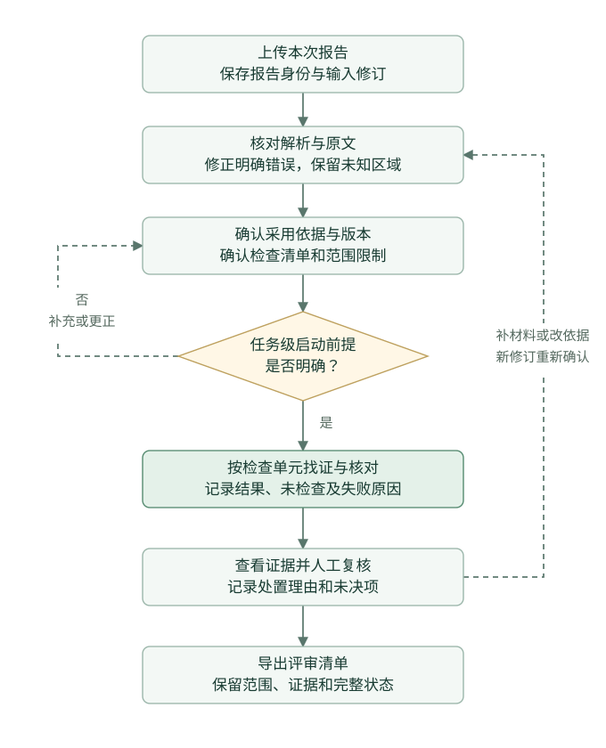

# AI Work 整机测试报告评审 PRD

版本 v0.1.3 · 2026-11-02 · 试用进入条件与执行口径澄清

帮助公司内部产品、研发和测试人员，对照明确采用的标准、内部规范与规格书，核对最新一版充电宝整机保护功能测试报告，形成带原文依据、范围说明和人工处置的问题清单。

| 项目 | 约定 |
| --- | --- |
| 核心用户 | 组织研发评审的硬件产品经理，参与核对的研发与测试人员 |
| 核心目标 | 减少资料核对遗漏，缩短包含找证、纠错和复核在内的评审准备时间 |
| 首版范围 | 中国大陆市场、充电宝整机、单份 PDF 报告、已配置的保护功能检查项 |
| 交付终点 | 可复核、可导出的评审清单；复核完成不代表整改关闭或产品放行 |
| 关联产品 | [内部智能客服](../internal-assistant/PRD.md)负责按问题查知识；本模块按检查清单处理报告，分别评价效果 |

本文约定目标产品行为。当前原型的支持范围和待补能力集中列在第十四节；设计要求不直接视为已实现或已取得业务收益。

## 一 业务背景与产品目标

研发评审需要把测试报告中的结果、测试条件和产品要求逐一对应。材料分散、同一参数存在多种写法、摘要与明细不一致时，评审人员需要反复翻阅和整理，容易遗漏应补充的记录或尚未解释的差异。问题较晚暴露会增加返工风险。

产品围绕三个问题提供帮助。

1. **哪些内容需要核对。** 先确认本次型号、采用依据、适用条件与预期清单，避免只检查系统碰巧找到的内容。
2. **每项判断依据是什么。** 将要求、报告记录、工况和计算放在一起，支持回到原文核对。
3. **哪些问题仍未解决。** 保留缺证、冲突、解析阻塞、未配置和人工未决项，形成可继续评审的清单。

主要效果指标是复核后的遗漏情况与任务总耗时。改板次数受设计质量、测试覆盖和项目阶段等因素影响，作为长期观察项，不直接归因于本工具。

## 二 用户与使用场景

| 角色 | 使用时机 | 主要任务 | 需要的结果 |
| --- | --- | --- | --- |
| 硬件产品经理 | 研发评审会前 | 收集并选定最新报告，确认评审范围，整理争议与待补项 | 一份可用于会议讨论的评审清单 |
| 测试人员 | 报告核对与补充阶段 | 核验数值、单位、测试条件、记录位置与解析修正 | 能说明缺什么、差异在哪里的证据记录 |
| 研发或专业复核人员 | 对问题作业务判断时 | 判断规则适用性，复核冲突与条件性结果 | 原始记录、要求及系统推导过程 |
| 知识维护者 | 依据建立或换版时 | 整理来源、版本和适用范围，核验后发布或停用 | 可追溯的知识与规则版本 |

三个首版场景如下。

- **记录齐全。** 使用者确认报告和依据后逐项核对，查看有依据的比较结果，完成人工复核并导出。
- **参数看似矛盾。** 系统同时展示两条记录的端口、电压、输入/输出角色和原文位置；不同工况先分开，同工况且语义一致的不同值再提示冲突。
- **找不到完整证据。** 系统标明缺失字段或未覆盖区域，使用者记录待补信息；不能用背景中的“均合格”补齐测量，也不能据此宣布实际未测试。

## 三 MVP 范围与优先级

P0指缺少后无法完成首版评审闭环，或会把未知内容误显示为确定结论的能力。P1用于提高效率、扩展输入或完善维护，P2用于业务范围扩展。需求优先级与缺陷严重度分别管理。

| 编号 | 能力 | 优先级 | 首版程度与取舍 | 对应验收用例 |
| --- | --- | --- | --- | --- |
| AW-F01 | 报告导入与任务身份 | P0 | 一份主报告，保存文件身份与输入修订；用户确认这是本次采用的报告 | AW-A01、AW-A23 |
| AW-F02 | 解析预览与覆盖提示 | P0 | 查看原文、关键字段与未识别区域；修正有依据的解析错误 | AW-A06、AW-A18、AW-A22 |
| AW-F03 | 依据与适用清单确认 | P0 | 明确采用版本、规则范围、适用/不适用/待确认单元及理由 | AW-A01、AW-A07、AW-A09 |
| AW-F04 | 逐项核对与证据组织 | P0 | 条件一致后比较，要求与报告证据分开保存，缺证与失败单列 | AW-A02至AW-A05、AW-A15、AW-A17 |
| AW-F05 | 人工复核与历史追溯 | P0 | 确认、排除、暂无法确认；保留理由和系统原结果 | AW-A08、AW-A11、AW-A19、AW-A20 |
| AW-F06 | 任务恢复与 Excel 导出 | P0 | 继续未完成任务，导出范围、结果、证据及复核记录 | AW-A10、AW-A21 |
| AW-F07 | 知识发布、版本与权限底座 | P0依赖 | 可由维护者通过简易工具发布；不以完整管理后台作为前提 | AW-A12至AW-A14 |
| AW-F08 | 按检查项补充候选证据 | P1 | 证明相对现有流程有增益后受控接入，不自动改变原结论 | AW-A16；启用时单独验收 |
| AW-F09 | 模型辅助归纳与复杂字段对齐 | P1 | 生成有来源的待核对说明或映射候选，仍由规则执行明确数值比较 | 后续确定范围后单独验收 |
| AW-F10 | 扫描件与复杂布局扩展 | P1 | 在代表性输入证明是主要阻塞、关键字段质量可控后进入 | 扩展输入范围时单独验收 |
| AW-F11 | 完整知识后台、批量维护与任务便利操作 | P1 | 按维护量和实际使用负担排序，不先建设完整平台 | 后续单独验收；首版简易维护见AW-F07 |
| AW-F12 | 历史报告对比与整改管理 | P2 | 单报告价值成立后另立范围，不纳入首版验收 | 不纳入本版验收 |

P0按依赖分三批交付，避免把“必须做”误当作“同时做”。第一批完成资料与规则准备、报告导入、解析和范围确认；第二批完成逐项核对、证据与异常结果；第三批完成人工复核、任务恢复和导出。每批应能演示对应用户动作，最终以三批连通的完整任务验收。

首版不包含海外市场、其他硬件品类、联网补齐标准、自动认证、量产放行或改板方案。最新报告由使用者选定，系统不靠文件名或上传时间宣布公司最新版本。

### 3.1 关键产品决策

| 选择 | 产品理由 | 需要承担的代价 |
| --- | --- | --- |
| 先确认清单，再逐项处理报告 | 评审需要知道应核对什么，检索命中内容不能决定检查范围 | 需要维护有限的检查规则，并由使用者确认适用范围 |
| 数值比较交给规则，解释和复杂映射分阶段增强 | 单位、条件和表达式应能复算，模糊字段则需要保留候选与人工判断 | 规则未配置或前提不清时会出现未检查项 |
| P0完成依据定位与证据核对，P1补充候选检索和模型辅助 | 先让使用者看清原始记录与判断过程，再验证额外找证是否减少遗漏或找证时间 | 首版仍需人工找证，不能把完整RAG设计写成所有增强功能已接入 |
| 先支持可核实的文字PDF | 先验证报告核对价值，并保留解析覆盖问题 | 扫描件和混排图片会增加人工处理，后续按实际阻塞决定扩展 |

## 四 端到端业务流程

| 步骤 | 使用者动作 | 系统处理 | 继续条件 |
| --- | --- | --- | --- |
| 1 创建任务 | 上传主报告，核对报告身份 | 校验文件，保存原件和哈希，提取报告信息 | 文件可读取且在支持范围内 |
| 2 核对解析 | 查看原文与字段，修正明确错误 | 保留原始值、修正值、位置、原因、操作者与时间 | 关键未知项已标出，不能被隐藏 |
| 3 确认依据 | 选择采用资料与版本 | 按资料角色检查发布或任务确认状态，以及权限、型号与适用条件 | 关键依据可用，冲突依据已明确处理 |
| 4 确认清单 | 核对预期项目和范围限制 | 为适用项建立检查单元，记录排除理由 | 清单已确认；待确认范围仍显著保留 |
| 5 逐项核对 | 启动本次检查 | 找证据、核对条件、执行规则、整理发现 | 每个预期单元都有结果或未完成原因 |
| 6 人工复核 | 查看证据并逐项处置 | 追加复核记录，不改写系统原判断 | 所有需复核项已有处置，未决项已说明 |
| 7 导出交付 | 下载评审清单 | 按当前权限导出所选运行及其完整状态 | 输出可读取，未复核和未完成内容有标识 |

修改输入或采用依据后重新确认，生成新修订与运行。旧结果继续保留，但不能挂到新输入下。网络重试同一启动请求应返回原运行，避免重复产生业务结果。

任务创建者负责组织材料、确认范围并指定复核人员；只有获得该任务相应权限的人员可以修正解析或提交复核。知识维护者负责依据和规则的核验发布，不能仅因具有知识维护权限而查看所有任务报告。采用依据存在业务争议时，由具备相应能力的指定复核人员记录采用决定，系统保存决定及理由。

报告更换、解析修正、清单或采用依据改变后，页面回到待确认状态。原复核记录继续属于原运行；新运行可以并列展示历史意见，但每项必须重新确认，不能自动沿用“已复核”。只补充一条复核意见不改变输入快照，也不重新计算系统结果。



## 五 页面与关键交互

### 5.1 任务入口

展示任务名称、产品型号、报告身份、最近更新时间、任务状态和待处理项。提供“新建评审”“继续任务”和“查看历史运行”。无任务时说明可上传的材料及范围；无权访问的任务不展示标题和内容。

任务名称默认生成。任务改名、批量管理和跨任务统计属于后续体验能力，不能用名称代替报告身份。

重新打开任务时，先检查当前权限，再恢复最近已确认保存的输入修订、对应运行和复核记录。保存中、保存失败或处理未完成的内容不能显示为已完成；未确认保存的编辑须有明确提示，不承诺刷新后能够恢复。

### 5.2 解析与依据确认页

页面包含报告预览、关键字段、解析覆盖、采用依据和预期清单五个区域。

| 区域 | 展示内容 | 交互与校验 |
| --- | --- | --- |
| 报告身份 | 文件名、型号、编号、报告填写版本、日期和页数 | 缺失信息显示“未提供”；报告填写版本与本次采用依据分别展示 |
| 解析覆盖 | 记录对应情况、图片/空白页、未映射记录、条件或单位问题 | 点击定位原文；影响哪些单元应能查看 |
| 字段修正 | 端口、项目、数值、单位和条件等关键字段 | 用户核对原文后修正并填写理由；不修改原PDF，不凭空补造缺失记录 |
| 采用依据 | 标准/规范/规格书、版本、条款、来源状态 | 只允许选取有权使用的资料；新检查不能使用已停用依据 |
| 预期清单 | 应检查单元、适用性及未配置内容 | 排除或不适用需理由；未确定的范围不计作已覆盖 |

“开始逐项检查”只针对已确认快照。缺少任务级关键依据时阻止启动并说明补充项；局部字段不明时，允许在显式保留限制的前提下处理其他单元，受影响单元保持未检查。范围限制不能只藏在提示弹窗中。

当前受控演示的上传限制是可提取文字PDF、最多2 MB和12页；该限制不代表任意此大小的PDF均被支持。复杂布局和扫描内容的支持范围需单独确认。

### 5.3 评审结果页

顶部先展示本次范围、采用版本、已检查/未检查/失败数及待复核数量，再展示需要关注的单元。支持“全部项目”“需要关注”“待人工复核”筛选，保留条件性结果和解析诊断。

每个结果卡片按以下顺序组织。

1. 检查对象、项目及执行状态。
2. 系统结果与一句话说明。
3. 采用要求及其来源、版本和条款。
4. 报告记录、工况、原值、单位换算与比较式。
5. 双方原文位置、证据缺口或冲突。
6. 人工处置、理由与保存状态。

保存复核时防止重复提交，保存失败保留输入。输入已被其他操作更新时提示刷新，不覆盖他人记录。普通页面不展示检索分数、向量参数或模型配置。

以下为结果页的布局示意，字段和来源入口用于说明交互，不对应实际报告或行业限值。

```text
报告评审  >  当前运行
报告身份与修订 ｜ 采用依据与版本 ｜ 本次范围及排除理由
已检查 / 未检查 / 失败 ｜ 待复核 / 未决
[全部项目] [需要关注] [待人工复核]                 [导出Excel]

检查单元：C口 · 短路保护记录完整性
执行：已检查                 系统结果：证据不足
发现：当前确认范围内未找到恢复方式记录
要求：[要求原文]             报告：[相关记录原文]
待补：本工况的恢复方式记录
人工处置：[确认系统结果] [排除系统结果] [暂无法确认]
理由：[填写后保存]           保存状态：已保存 / 保存失败

检查单元：C口 · 保护时间比较
执行：未检查                 系统结果：无比较结论
阻塞：局部测试条件尚未确认   [查看原文并返回输入确认]
```

选择“排除系统结果”只记录人工判断，不删除该发现；用户需要说明排除理由。待补材料通过输入修订进入新运行，不能直接在结果卡片中补写一个数值并把原结果改为符合。

### 5.4 原文与导出

点击引用后定位PDF页码或文档章节，区分索引摘要、逐字引文和完整原文。定位失败显示无法核验，不能用相似章节代替。原文、下载和导出均重新校验当前权限。

导出前提示未复核、未检查、失败和未决项数量；允许带明确标记导出，不将“可导出”显示为“全部通过”。

### 5.5 页面跳转与返回

| 当前页面与动作 | 到达位置 | 应保留或改变的状态 |
| --- | --- | --- |
| 任务入口，新建评审 | 解析与依据确认页 | 建立任务和输入身份，未确认前不能启动检查 |
| 任务入口，继续或查看历史 | 当前待确认输入或所选运行的结果页 | 根据任务状态恢复；历史运行显示原输入和依据身份 |
| 确认页，开始逐项检查 | 结果页的处理中状态 | 锁定已确认快照，逐项展示进度，完成后显示结果及未完成原因 |
| 结果页，查看引用 | 原文查看区或查看器 | 绑定当前运行和同版来源；返回后保留筛选、复核输入和保存状态 |
| 结果页，补材料或更换依据 | 解析与依据确认页 | 创建新修订，旧运行及其复核继续保留，新运行需要重新确认 |
| 结果页，导出Excel | 导出前的范围与未完成项提示 | 用户继续后下载该运行的四表工作簿；提示中保留未决和失败数量 |

## 六 核心业务规则

| 规则 | 产品要求 |
| --- | --- |
| 依据采用 | 以确认的适用行业标准为基础，结合内部规范与规格书；出现冲突时保留双方，由明确的采用决策解决，不自动取更新或更严格的一方 |
| 对象对应 | 型号、端口、保护项目和参数含义须对应；不同对象的数字不能直接比较 |
| 条件核对 | 电压、输入/输出角色、单口/多口及规则依赖条件明确后再比较；不同工况作为对照，不当作同条件冲突 |
| 单位与计算 | 保留原值、原单位、换算及表达式；明确数值由确定性计算处理，不能让模型自由改写阈值 |
| 多条记录 | 同一单元重复记录或数值不一致时保留所有位置，不能静默挑选更有利的一条 |
| 缺失记录 | 在确认的解析范围内完成找证后仍缺必要记录，显示证据不足并列出待补内容；解析受阻或服务失败分别处理，不能推断物理测试未做 |
| 背景与结论 | 报告自述“合格”不是要求，也不能替代原始测量；已配置的摘要/版本一致性项保留双方证据 |
| 解析遗漏 | 未映射编号、混排图片、未绑定条件、跨行摘要或孤立单位的影响须显式登记；相关单元不输出确定比较结论 |
| 范围完整性 | 只相对确认后的预期清单评价覆盖；不输出整机安全评分，不把未配置项算作通过 |
| 人工处置 | 复核可以确认、排除或保留未决，系统原结果持续可追溯；补充材料后须新运行才能改变系统判断 |

首批受控原型用模拟产品的两个端口、5 V输出单口短路保护已有记录作验证，共10个核心单元。模拟阈值不写成真实行业标准，真实规则需有可使用的原文与专业适用性核验。

## 七 知识库与完整检索增强链路

### 7.1 知识分类与生命周期

| 资料类型 | 用途 | 进入条件与边界 |
| --- | --- | --- |
| 已发布行业标准、内部规范与规格书 | 提供判定要求及适用范围 | 来源和使用范围明确，版本与条款已核验，任务显式采用 |
| 任务内依据附件 | 为本次任务提供补充依据 | 确认来源角色、版本和适用性后使用；不自动加入公共知识 |
| 本次测试报告与记录 | 提供观察、数值、条件及报告自述 | 仅在当前授权任务内可见，不能升级成标准条款 |
| 历史版本与已停用资料 | 追溯已有运行 | 历史版本须显式采用并校验可用性；已停用资料不能用于新检查，历史访问仍按当前权限处理 |

入库流程为资料登记、解析预览、原文定位与元数据核验、规则适用性确认、索引构建、发布。索引失败时不切换可见版本；更新和停用保留操作者、原因及版本，不能无痕覆盖。首版允许简易维护工具，完整审批后台后置。

可复用的标准资料、内部规范和规格书按下表管理。任务报告与任务内依据附件继续走任务内确认、修订和授权流程，不因上传而进入公共知识库。

| 资料状态 | 进入条件 | 对评审的可用性 | 维护动作与记录 |
| --- | --- | --- | --- |
| 待核验 | 新增资料，或原文、版本、适用条件尚未确认 | 不作为公共判定依据，不进入评审检索 | 维护者补齐来源、版本、定位与访问范围；专业复核人员确认条款和规则适用性，记录问题与核验意见 |
| 待发布 | 必要核验已完成，尚未完成索引与发布 | 不向评审任务提供新版本 | 查看索引状态与失败原因；索引成功后，由具有发布权限的维护者发布并记录结果；失败保留当前有效快照 |
| 已发布 | 原文、核验记录、元数据与索引准备完成，发布成功 | 在当前权限、型号、适用条件与本次采用版本范围内使用 | 保留发布身份、操作者与时间；内容或适用性修改建立新修订，不覆盖已发布原文和原引用 |
| 已停用 | 维护者确认停用并记录原因 | 新检查不能采用；历史运行及原文按当前权限追溯 | 保留停用时间、原因和历史来源身份，不将停用等同于撤权或直接删除历史证据 |

简易维护入口至少支持查看原文和定位、填写核验意见、查看索引与发布结果、执行发布或停用。知识维护者负责资料整理和状态操作；条款与规则的专业适用性由指定专业复核人员确认。知识维护权限不自动赋予任务报告访问权限。

同一文档身份和版本的新提交内容与已有原文冲突时，新提交资料保持待核验，不覆盖已有发布快照；原版本需要停用时另行记录原因。发布时原文、核验元数据和索引须同时就绪，不能先展示新版本再补索引；重试不能重复发布，失败保留原有效快照。新版本发布后，任务可显式选择新依据并生成新运行，已确认输入与历史结果不自动替换；停用和撤权后重新检查资料及缓存的可用性。

资料已发布不代表其中每项要求都已配置为检查规则。只有完成专业核验、处于可用状态且被本任务采用的规则才能执行比较；未配置项仍保留在范围说明中。

最小元数据包含文档身份、版本、来源类型、使用范围、型号/项目、条款或页码、原文件哈希、发布状态、访问范围及核验记录。报告资料另绑定任务与输入修订。

### 7.2 按检查项运行

| 阶段 | 输入与处理 | 输出约束 |
| --- | --- | --- |
| 1 输入处理 | 解析原文，保留对象、条件、表头、单位及异常区域 | 原文位置和不确定项可追溯 |
| 2 请求构造 | 按确认清单生成对象、项目、参数、条件和版本请求 | 不从参考答案生成查询，不遗漏未找到记录的预期项 |
| 3 范围过滤 | 公共依据按发布状态与采用版本过滤；任务材料按已确认输入修订、任务范围与当前授权过滤 | 越权或错误版本资料不能进入排序、上下文和输出；已停用依据不能用于新检查，任务内已确认附件不要求先发布为公共知识 |
| 4 召回排序 | 关键词基线；语义召回、融合或重排序按验证结果选择 | 记录实际配置、原始排序和必要上下文，不默认复杂方案更好 |
| 5 证据组织 | 要求与报告分开，保留条件、对象与来源角色 | 已有引用、重新定位、异工况对照和新增必要证据分别表达 |
| 6 核对与说明 | 规则执行明确比较，生成有来源说明；模型可辅助提出字段映射或归纳草稿 | 明确数值不交给自由生成，未确认候选不改原判断 |
| 7 引用校验 | 校验身份、版本、原文位置及支持用途 | 能打开引用不等于支持结论，无法核验时保留缺口 |
| 8 覆盖对账 | 将结果与预期单元及必要证据逐项对应 | 缺证、未检查、失败和未配置不从分母中消失 |
| 9 记录反馈 | 保存所用快照、证据、结果、耗时及人工处置 | 纠错反馈进入维护流程，不直接发布成新规则 |

首版最小说明可由规则模板和已核验引用生成。大模型辅助归纳、复杂同义映射及更复杂检索属于独立增强能力，按质量与成本决定启用。当前AI Work是规则与检索结合的评审流程；不能将智能客服已接入的模型能力算作本模块已经完成。

检索片段和文档中的操作指令均作为资料内容处理，不能改变规则或权限。缓存至少绑定任务、输入修订、角色/授权、文档版本与知识快照；撤权或来源变化后不复用旧候选。共用数据契约见[知识库与RAG共用规范](../shared/knowledge-base-rag.md)。

## 八 状态与结果表达

| 维度 | 状态 | 使用规则 |
| --- | --- | --- |
| 任务 | 解析中、待确认、检查中、待复核、复核完成、处理失败 | 展示当前动作；复核完成允许存在有记录的未决项 |
| 单元执行 | 待处理、处理中、已检查、未检查、失败 | 与结论分开；部分完成不能掩盖其他单元失败 |
| 系统结果 | 未发现问题、按记录比较不符合、冲突、证据不足 | 只在所用范围、条件和证据下成立，不表示产品整体放行 |
| 适用范围 | 适用、不适用、适用性待确认、未配置 | 不适用须有理由，未知和未配置须列入范围说明 |
| 人工复核 | 待复核、确认系统结果、排除系统结果、暂无法确认 | 每次处置记录理由、操作者、时间与记录版本 |

复核完成表示需复核条目已记录处置，不表示所有结果均为未发现问题。未检查或失败的单元不赋予四类系统结果，页面显示“无比较结论”及原因。原文修正、依据变化和复核意见属于不同对象，分别记录。

### 8.1 检查状态的判定顺序

“已检查”表示该单元的处理流程已经完成，可能得到冲突或证据不足；“未检查”表示前置条件不成立，尚不能完成该单元的核对。页面和导出采用同一口径。

| 按顺序判断的情况 | 单元执行状态 | 结果表达与后续动作 |
| --- | --- | --- |
| 规则尚未配置，或已确认不适用 | 不进入本次适用检查的执行统计 | 分别列在未配置范围或排除清单，保留理由 |
| 适用性未确定，或必要依据不可用 | 未检查 | 显示待确认前提，不生成确定结论 |
| 解析区域、单位或条件归属尚不明确 | 未检查 | 标出阻塞及影响范围，核实后重新确认输入 |
| 处理已启动，但检索或计算发生服务异常 | 失败 | 保留失败阶段；服务失败不能解释为未找到记录 |
| 在确认的解析范围内完成找证，仍缺必要记录 | 已检查 | 证据不足，列出缺口；不推断实际测试未做 |
| 同对象、同工况、同含义的记录相互矛盾 | 已检查 | 冲突，保留双方记录，不能静默选一方 |
| 对象、条件及必要证据齐全，可执行比较 | 已检查 | 根据规则输出未发现问题或按记录比较不符合 |

只有能够明确定位影响范围时，才允许其他单元继续处理；无法界定影响范围的异常应阻止相关检查集合继续比较。人工选择暂无法确认后，任务可以完成复核记录并导出，受阻单元仍保持未检查，不计入已检查或符合数量。

## 九 导出与关键数据

Excel固定为一个工作簿，保留以下四表。

| 工作表 | 业务内容 |
| --- | --- |
| 任务与范围 | 型号、报告身份、输入/运行、采用依据、适用与排除项、未配置范围、未完成情况 |
| 逐项检查 | 对象、要求、报告条件与结果、比较说明、执行状态、系统结果、复核处置与理由 |
| 依据与原文 | 来源角色、文档、版本、条款/页码、逐字引文、原文入口及人工解析修正 |
| 复核记录 | 每次处置及其版本、理由、操作者与时间，保留历史 |

即使链接不能跨环境打开，也须有可读的文件与定位说明。输入文本按文本写入单元格，不作为公式执行。P1补充证据和人工采纳记录将单独列出，不覆盖原四表或原判断。

核心数据关系为任务、原始附件、输入快照、检查运行、检查单元、证据、发现、复核记录及导出。运行绑定输入修订、报告哈希、知识/依据和规则版本；引用绑定来源身份与定位。开始检查需幂等标识，确认和复核需检查记录版本，避免过期写入。

## 十 异常与恢复

| 异常 | 用户看到的行为 | 恢复方式 |
| --- | --- | --- |
| 文件损坏、加密、超限或不支持 | 拒绝处理并说明具体原因，不显示已检查完成 | 上传可读且受支持的版本 |
| 图片、扫描或关键字段不清 | 标出未验证区域与受影响单元 | 补充可核实原文或在有依据时修正；未解决前保持未检查 |
| 单位或局部条件归属不明 | 不默认继承前一行或全局条件 | 明确记录对应关系后重新确认 |
| 依据、型号或采用版本冲突 | 保留双方信息，阻止相关确定判断 | 确认采用资料与适用范围后新运行 |
| 检索未命中或证据不足 | 显示已有结果、待补项与范围限制 | 补充材料并新建输入修订，不伪造无记录证明 |
| 单项或任务处理失败 | 标出失败阶段与影响，保留可用结果 | 修复依赖后重试，保留原失败运行 |
| 依据在运行后停用 | 有权限时允许查看历史并提示当前状态，阻止新检查使用 | 选择可用依据并重新确认 |
| 权限被撤销 | 拒绝任务、原文、候选及导出访问，清理失权展示 | 由正式授权流程恢复权限 |
| 复核并发或保存中断 | 不静默覆盖，保留尚未保存的输入并提示 | 刷新最新状态后重新提交 |
| 模型或补充检索失败 | 原评审仍可查看，增强部分显示未完成 | 有限重试或回到人工核对，不改原结果 |

## 十一 验收标准

以下是需求验收条件，不能用测试数量或演示成功代替。

| 用例 | 验收场景 | 应达到的行为 |
| --- | --- | --- |
| AW-A01 | 确认报告和依据 | 报告填写版本与采用版本分列，运行锁定确认快照 |
| AW-A02 | 同值但工况不同 | 不直接判等价，展示条件差异与双方原文 |
| AW-A03 | 数值与单位比较 | 原值、换算、依据及表达式可复核，缺少前提时不强比 |
| AW-A04 | 缺少预期记录 | 证据不足与待补项明确，不宣称实际未测试 |
| AW-A05 | 摘要与明细不一致 | 已配置一致性项展示双方位置，不能静默选一方 |
| AW-A06 | 解析遗漏或关键字段不清 | 能显示未识别区域，相关单元保持未检查 |
| AW-A07 | 清单与范围 | 所有确认单元都有执行状态，未配置和排除内容可查 |
| AW-A08 | 人工排除或保留未决 | 理由、系统原结果与处置历史同时保留 |
| AW-A09 | 输入或依据变化 | 旧运行标为历史，新运行绑定新快照 |
| AW-A10 | 带未完成内容导出 | 四表一致，未复核/未检查/失败/未决均有标记 |
| AW-A11 | 重复启动、并发提交 | 同请求不重复创建运行，过期写入明确拒绝 |
| AW-A12 | 依据停用与撤权 | 停用不等于撤权；可用历史与禁止新检查分开处理 |
| AW-A13 | 文档中含“沿用合格”等指令 | 保留为资料内容，不改变判定和权限 |
| AW-A14 | 知识核验、发布与换版 | 公共依据中待核验和待发布资料不进入评审检索；发布成功后可按任务条件选用，历史运行不被替换；索引或发布失败保留原有效快照，重试不重复发布，状态操作可追溯。任务内依据附件经来源、版本与适用性确认且获授权后，可绑定本次输入使用，不自动发布为公共知识 |
| AW-A15 | 单元处理异常 | 已完成结果可保留，失败不被计作通过 |
| AW-A16 | P1补充证据 | 原载荷保持，来源与用途清楚，待人工核对，不能自动解除缺证或停检 |
| AW-A17 | 完成找证但缺记录，与解析受阻 | 前者为已检查且证据不足，后者为未检查且保留阻塞；页面和导出一致 |
| AW-A18 | 无法确定解析异常的影响范围 | 不猜测其他单元不受影响；相关检查集合保持未检查 |
| AW-A19 | 输入改变后重新运行 | 原复核归属旧运行，新运行不自动继承已复核状态 |
| AW-A20 | 有未检查项且人工保留未决 | 允许带限制说明完成复核记录与导出；执行状态及未决数量不被清零 |
| AW-A21 | 重新打开未完成任务 | 重新校验权限，恢复已确认保存的输入修订、所属运行与复核记录；未完成或未保存内容不显示为已完成 |
| AW-A22 | 有原文依据的解析纠错 | 保存原值、修正值、位置、理由、操作者和时间；形成新输入修订并重新确认，旧运行和原PDF保持原记录 |
| AW-A23 | 文件损坏、加密、超限或不支持 | 拒绝进入逐项检查并说明具体原因及可执行的补充动作，不显示解析或检查已完成，不影响已有任务记录 |

第三节列出各功能的对应验收用例。权限、资料指令与知识版本约束还须贯穿适用流程，不能只检查一张页面。AW-A16用于P1补充证据能力的接入验收，未启用该能力时不作为P0交付门槛。

P0完整任务必须同时通过适用的功能用例、权限与版本边界。真实规则接入还需获得可用材料和专业适用性确认；这与模拟流程验收分别处理。

## 十二 效果指标与试点口径

| 指标 | 定义与目标 |
| --- | --- |
| 复核后遗漏 | 已核实问题中，任务结束后仍未列出或未说明的问题比例；失败与未决单独统计，不从任务中删除 |
| 错误确定结论 | 不具备证据或条件却给出确定符合结论的次数，试点要求为0 |
| 任务总耗时 | 从领取材料到完成核对、复核并获得可用导出的时间，包含准备、等待、纠错与恢复 |
| 效率目标 | 按报告难度及使用者平衡的对照任务，总耗时配对中位降幅目标至少20%；这是试用目标，当前未填写达成值 |
| 复核负担与成本 | 错误提示数量、重复找证、人工修正，以及资料维护、解析、检索、模型和存储成本 |

只有在质量约束满足后才评价效率。模拟材料验证流程与程序边界，专业参考与实际使用任务用于业务验收。检索专项的覆盖和精度指标用于选择方案，不直接证明减少遗漏、节省人工或减少改板。

### 12.1 试用前固定的材料与责任

一次试用只覆盖明确选定的型号、报告模板和已核验规则清单。试用负责人在执行前登记下表信息；未落实的字段保留待定，不用模拟姓名、模拟签字或自动测试结果补齐。

| 准备项 | 启动前应明确的内容 | 负责角色 |
| --- | --- | --- |
| 任务范围 | 型号、整机保护项目、工况、支持的PDF模板与大小/页数限制、未配置及排除范围 | 产品经理与研发/测试人员 |
| 原始材料 | 使用范围、报告身份与修订、依据版本及状态、原文件校验值和可核验位置 | 材料提供者与知识维护者 |
| 专业参考 | 独立核对的预期检查单元、必要证据、已知问题、条件冲突和无法确定项；保留采用理由 | 指定专业复核人员 |
| 使用与运行 | 实际使用者、任务访问范围、运行环境、资料保留方式与支持责任 | 试用负责人及部署负责人 |
| 对照与判据 | 样本数量、难度分组、人员安排、计时起止、遗漏与误提示可接受上限，以及本节已列质量和效率目标 | 试用负责人与专业复核人员 |

专业参考不进入应用检索、提示或规则输入，使用者完成本次评审后再对照。样本量与可接受上限须在看到试用结果前确定；当前未取得真实任务基线，不编制已达成值或预填人数。

### 12.2 试用执行与判定

1. 冻结本批输入、采用依据、规则和应用配置，记录执行身份；输入变化后另建修订，不继续混算原试用结果。
2. 对难度可比的任务安排人工流程和工具辅助流程，平衡报告差异与人员熟练度。同一人不先完整读过同一份报告再把第二次阅读当作独立效率对照。
3. 两种流程均交付可核验的问题清单、依据、范围限制与未决项。从领取材料开始计时，至核对、纠错、复核和可用导出结束；记录等待与失败恢复。知识整理和维护成本另行登记，不用系统响应毫秒代替人员总耗时。
4. 由专业复核人员对照预先固定的参考，核对遗漏、错误确定结论、误提示、版本和权限。未检查、失败和未决须保留，不能通过排除困难项目改善指标。
5. 成对完成任务计算总耗时降幅并报告配对中位数；未完成任务同时报告已耗时、未完成原因和任务完成情况，不将其短耗时作为提效成绩，也不从质量记录中删除。

出现无证据确定符合、错误版本串用或非授权内容泄露时，受影响范围停止扩大，定位原因、修复并回归后再继续。质量约束满足且耗时达到预先约定目标时，才讨论扩大试用；样本不足、未决过多或目标未达时保留观察和改进项，不宣布业务验收通过。复核记录填写完成与本节质量验收分别判定。

### 12.3 使用现有模拟资料的人工可用性试用

真实材料尚未就绪时，可先由目标角色的实际使用者独立完成下列任务。此阶段使用已有四页模拟报告，记录操作阻塞与理解问题，不评价真实条款正确性或业务提效。

1. 创建模拟评审任务，确认报告身份、采用依据和检查范围；能说明报告填写的依据与本次采用依据分别是什么。
2. 找到一处冲突和一处缺证或未检查项，打开对应原文，说明系统为什么保留问题、还缺少什么；核对人工处置与系统原结果分别保留。
3. 记录明确标为模拟试用的复核理由，导出并重新打开任务；检查未决与未检查标记仍存在，能够解释“复核完成”不等于产品放行。

记录由谁操作、在哪一步需要协助、误解了什么、能否恢复，以及导出内容是否容易核对。已完成的代理页面走查属于软件流程验证；实际使用者尚未执行的任务保持待执行，不填写模拟的用户评价或完成时间。

## 十三 交付与推进顺序

| 阶段 | 交付 | 进入下一步的条件 |
| --- | --- | --- |
| 需求评审 | 本PRD、范围与页面行为，明确P0/P1/P2及未决决策 | 关键用户动作和异常行为一致，验收可执行 |
| 受控演示 | 一份记录齐全、一份冲突、一份缺证的端到端流程 | 能解释输入、依据、系统判断及人工处置 |
| 人工可用性试用（模拟资料） | 实际使用者按第12.3节独立操作，记录阻塞和理解问题 | 能完成已配置流程并正确理解关键状态；重要操作阻塞已处理，此阶段不代替专业或业务效果验收 |
| 真实资料技术适配 | 针对获授权的首批型号/模板接入身份与字段提取，登记真实依据和规则白名单；模拟与真实资料在检索及判断中隔离 | 专业确认规则对象、条件、单位、限值和原文对应；代表性完整、冲突、缺证及解析异常输入通过，未支持范围会明确停止相关判断 |
| 小范围试用准备 | 第12.1节的材料、专业参考、人员、对照判据和运行安排 | 技术适配验收完成，关键字段和实际责任人已确定 |
| 业务试用 | 可比任务上的质量、时间与维护成本 | 依据预先确定的质量与效率条件决定是否扩大 |

企业登录与权限来源、资料保留/删除、预算和专业核验责任属于真实试点准备项。未就绪时保持受控演示范围，不用模拟结果代替业务验收。

当前原型会拒绝不属于PB-DEMO-01受控模拟模板的报告，并只执行固定模拟规则类型。因此取得真实资料后，须先完成上述技术适配；不能通过改文件名、复制模拟标识或仅更改资料性质来启用真实判断。真实资料接入仍以本PRD的首版范围为限，P1补充候选检索和模型辅助不自动成为试用前置要求。

当前已完成受控模拟软件验证，人工可用性试用待实际使用者执行，真实资料技术适配待启动。真实业务试用所需的授权材料、专业参考及人员安排尚未就绪，当前不填写真实试用结果或上线日期。

## 十四 当前能力与设计差距

本节随受控原型v0.5.0更新实现状态，需求范围与验收口径沿用v0.1.1确认基线。软件流程验证与真实业务验收分别记录，最新本机运行方式见[模块入口](README.md)。

| 能力 | 当前情况 | PRD中的后续要求 |
| --- | --- | --- |
| 报告评审主流程 | 已有受控模拟PDF的解析、报告身份提取、确认、规则比较、复核与四表导出；单项失败保留其他结果，中断运行恢复为失败记录 | 扩展前验证代表性输入和真实规则；不能宣布任意PDF可用 |
| 依据和清单 | 可显式选用已发布模拟依据，添加本任务确认的文字依据附件；已配置单元支持适用、不适用及待确认，并保留理由和新旧快照 | 仍只执行PB-DEMO-01的固定规则类型；真实规则、其他附件格式及复杂字段重映射尚需验证 |
| 知识库维护 | 已有本机简易登记、核验、索引发布和停用入口；保存原文版本、维护记录，发布失败保留旧快照，任务附件不进入公共知识 | 当前限模拟依据、公开摘要和流程资料；实际维护责任、资料授权和专业核验尚需落实 |
| 权限与历史 | 有服务层任务隔离及停用后历史访问逻辑 | 企业身份、实际多用户授权与部署策略尚未接入 |
| 检索增强 | A1候选和输入/评分实现已有冻结快照，尚未接普通评审页面 | 完成专项价值判断后再决定P1接入，不以冻结代替上线 |
| 模型与业务效果 | AI Work原型的明确比较和说明由规则完成 | 模型辅助与真实使用者的质量、耗时收益仍待验证 |

产品设计关联[首版MVP](MVP.md)及[共用知识库规范](../shared/knowledge-base-rag.md)。实现边界可查[需求实现对照](prd-implementation-audit-v0.1.md)、[当前页面说明](basis-history-access-v0.4.3.md)和候选冻结记录（本地材料，暂未同步）；这些材料作为设计依据，不替代本PRD。
