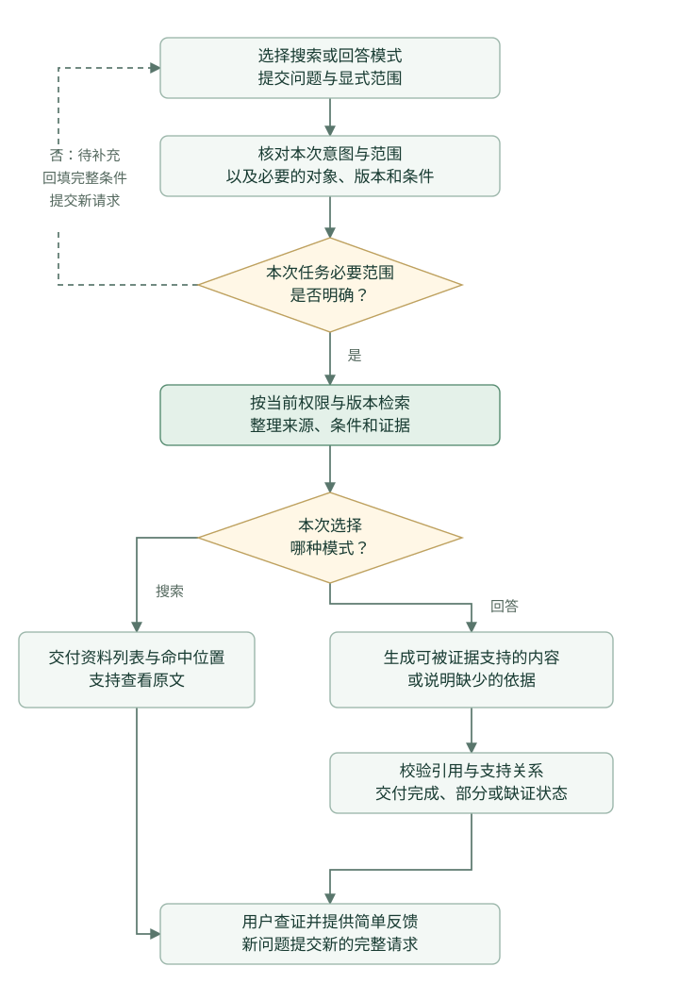

# 内部智能客服 知识检索与问答 PRD

版本 v0.1.3 · 2026-11-02 · 试用进入条件与执行口径澄清

为公司内部产品、研发和测试人员提供充电宝整机保护功能知识的搜索与单轮问答，帮助使用者找到适用资料、理解要求并核对原文。

| 项目 | 约定 |
| --- | --- |
| 核心任务 | 找资料、查要求、理解条款、比较显式选定的资料差异 |
| 首版交付 | 资料搜索、基于知识库的单轮回答、引用定位、无依据/冲突处理和简单反馈 |
| 知识范围 | 中国大陆市场，充电宝整机保护功能相关的已发布规格、标准资料和内部规范 |
| 关联模块 | [AI Work](../ai-work/PRD.md)负责完整报告逐项评审；问答不代替清单核对 |
| 版本性质 | 本文定义目标需求；当前受控原型和未完成能力见第十三节 |

## 一 业务背景与产品目标

研发知识分散在标准、规格书、内部规范和任务材料中。使用者常知道要查什么，却难以迅速找到适用版本和对应章节；同名参数、历史资料或不完整引用也会增加理解成本。

产品以“取得正确依据并能解释其适用条件”为任务完成标准。仅返回一个看似合理的答案、打开一份文件或命中相似词，都不代表用户已经完成查证。

主要目标为缩短正确完成资料查找任务的总耗时，并减少版本串用、引用不符和无依据确定回答。首版提供直接搜索，使用者不必为获取一条原文被迫生成长回答。

## 二 用户与典型场景

| 用户 | 典型问题或任务 | 应交付的结果 |
| --- | --- | --- |
| 产品经理 | 某型号的保护要求采用哪份规格，在哪里查看？ | 对应文件、采用版本、适用范围和原文位置 |
| 测试人员 | 某项已有测试记录应包含哪些条件和字段？ | 有来源的要求说明，区分必须记录与尚不明确的信息 |
| 研发人员 | 两份已选资料对同一参数的描述为什么不同？ | 并列来源、版本和条件，明确差异而不擅自裁决优先级 |
| 新接手项目的内部人员 | 在授权范围内查找项目术语或相关规范 | 可读片段、必要术语解释及进一步查证入口 |
| 知识维护者 | 收到缺失资料或错误引用反馈 | 可定位到请求、知识版本和证据的纠错记录 |

场景示意包括查找规格文件、解释已收录要求、核对历史版本和处理知识缺口，不作为已有真实问题日志或业务量统计。

## 三 MVP 与优先级

| 编号 | 能力 | 优先级 | 首版要求 | 对应验收用例 |
| --- | --- | --- | --- | --- |
| QA-F01 | 资料搜索 | P0 | 支持关键词或自然语言搜索，返回当前可访问的资料与命中位置 | QA-A01、QA-A06、QA-A21 |
| QA-F02 | 单轮RAG回答 | P0 | 基于本次检索证据回答，保留对象、版本与必要条件 | QA-A02、QA-A10、QA-A12、QA-A17、QA-A22 |
| QA-F03 | 原文与引用查看 | P0 | 结论可定位到对应资料，索引摘要与原文分开展示 | QA-A07、QA-A11、QA-A12、QA-A13 |
| QA-F04 | 范围、无依据与冲突处理 | P0 | 有歧义先补条件，无足够证据不编造，不混用不同来源角色 | QA-A03至QA-A05、QA-A08、QA-A15、QA-A16、QA-A18、QA-A19 |
| QA-F05 | 简单反馈 | P0 | 记录有用/有误、问题类型和可选备注，关联本次请求 | QA-A14、QA-A20 |
| QA-F06 | 知识发布与访问底座 | P0依赖 | 可追溯入库、审核、索引和发布；检索与原文执行同一授权 | QA-A06、QA-A09、QA-A13、QA-A14 |
| QA-F07 | 多轮追问与会话记忆 | P1 | 单轮稳定且有连续追问需求后，单独处理型号/版本切换和会话隔离 | 扩展多轮范围时单独验收 |
| QA-F08 | 复杂查询规划与检索优化 | P1 | 对存在的检索缺口比较查询改写、语义召回和重排序的收益与成本 | 后续按具体检索缺口单独验收 |
| QA-F09 | 完整知识管理与反馈后台 | P1 | 维护量形成实际瓶颈后建设审批、批量处理、回滚和运营界面 | 后续单独验收；首版简易维护见QA-F06 |
| QA-F10 | 跨硬件领域与外部客服 | P2 | 另立知识、权限、用户和服务边界，不沿用本版效果结论 | 不纳入本版验收 |

P0分三批推进。第一批打通知识入库、授权搜索和原文查看；第二批接入有依据回答及条件、版本和缺证处理；第三批补齐反馈、失败恢复和完整任务验收。向量检索可作为召回方案参与比较，未建立向量索引时须说明实际使用方式，不能伪报混合检索已生效。

本版不做消费者售后客服、开放网络补标准、自动认证或技术放行，也不把完整报告评审包装成一次问答。需要系统检查报告时提供AI Work入口。

### 3.1 关键产品决策

| 选择 | 产品理由 | 需要承担的代价 |
| --- | --- | --- |
| 搜索资料与有据回答分别提供入口 | 已知文件的使用者可以直接取证，需要理解内容时再生成回答 | 两种模式分别定义成功标准，搜索命中不计作回答正确 |
| 首版采用单轮问答 | 每次问题都能确认实际使用的对象、版本和任务范围，便于控制串用 | 补充条件需要提交完整新请求，连续追问体验留待P1 |
| 知识更新走入库和发布流程 | 依据的版本、原文和适用性可以独立更新与追溯，反馈也能定位到维护对象 | 资料整理、核验和换版需要明确维护责任 |
| 召回方案按任务效果选择 | 精确型号、标准号与语义问法需要兼顾，同时控制等待和调用成本 | 向量、融合和重排序分别验证，不能以组件更多代表效果更好 |

## 四 用户流程

1. 使用者选择“搜索资料”或“基于资料回答”，输入问题或关键词。
2. 选择本次使用的资料/版本及必要的任务范围；不选择任务时不使用任务报告。
3. 系统识别问题中的型号、项目、参数、标准号、单位与版本，检查影响适用性的条件。
4. 在当前授权范围内检索，返回来源、命中片段和位置；存在关键歧义时列明要补充什么。
5. 回答模式下，以核验后的证据生成回答，并把引用绑定到具体结论。
6. 使用者打开原文完成查证，必要时反馈错误或知识缺口。
7. 下一次提问生成新请求，不隐式继承上次答案里的型号、版本或推断。

界面当前显式选择的范围可以保留，但每次请求都应展示并提交实际采用条件。单轮不等于每问清空所有表单，也不允许系统暗中把上一问条件带入新问题。

当系统返回待补充时，页面可以提供“补充条件”操作，将原问题和已填写的范围带回表单，并突出缺少的字段。使用者确认完整条件后提交一个新请求；系统采用本次提交的内容，不读取上一轮答案来推断条件。切换任务或型号后，清空不再适用的资料选择；问题正文与范围控件冲突时，先让使用者确认采用哪一项。

文件定位类搜索可先列出授权候选；条件澄清只针对会改变本次结果适用性的缺口，不要求使用者为查找文件补齐无关技术条件。



## 五 页面与交互

### 5.1 查询区

查询区包含模式切换、输入框、范围条件、任务资料选择和提交按钮。

| 元素 | 行为要求 |
| --- | --- |
| 搜索/回答模式 | 搜索只返回资料，无须调用生成模型；回答在证据充分时生成有引用内容 |
| 输入框 | 空输入不能提交；超限时提示缩短，不静默截掉型号、版本或关键条件 |
| 范围条件 | 显示当前领域、资料/版本及任务范围；历史版本通过显式条件进入 |
| 示例问题 | 用已标识的资料示意支持范围，不能暗示真实标准全文或全部技术限值均已收录 |
| 处理中 | 显示检索或生成阶段，防止重复提交；不能把未完成输出显示为最终回答 |

普通使用者不需选择模型、向量维度、检索分数或提示参数。模型连接和知识维护属于维护者的独立操作。

### 5.2 搜索结果与资料卡片

资料卡片显示名称、来源类型、版本/状态、适用对象、命中片段及页码或章节。支持打开原文；已有摘要和原文不一致时说明片段性质，不把目录摘要当逐字引用。

只有当前可访问的资料可以出现在卡片中，无权资料不泄露标题、片段或存储路径。选中历史版本时显示“历史资料”，防止误用为本次现行依据。

### 5.3 回答区

回答区先给能确认的结论，再给必要条件、引用与缺口。格式随问题调整，不为所有问题固定生成长报告。

| 问题类型 | 回答组织 |
| --- | --- |
| 找文件 | 文件与适用版本、为什么相关、原文入口 |
| 查参数或要求 | 对象/条件、要求、来源位置；缺少型号或版本时说明影响 |
| 理解内容 | 简洁解释及关键限定，涉及推断时明确区分 |
| 比较资料 | 双方版本、条件、差异及尚不能确定的采用关系 |
| 证据不足 | 可确认部分、具体缺口及补充信息建议 |

不同来源的结论分别保留引用。报告记录可以说明“本报告记载了什么”，不能独立支持“标准要求是什么”。

下面的布局用于说明操作与证据关系，来源和字段摘要均为设计占位，不作为具体标准要求。

```text
知识检索与问答
[搜索资料] [基于资料回答]
当前范围：型号 / 资料与版本 / 任务材料（可选）
问题：[输入需要查找或理解的内容]                    [提交]

回答状态：已完成 / 部分回答 / 待补充 / 无充分依据 / 处理失败
结论：能够确认的内容 [引用1]
适用条件：对象、版本及必要工况
未确认部分：具体缺少的资料或条件（有缺口时展示）

引用1：资料名称 · 版本 · 来源类型 · 页序或章节
逐字引文：[保留必要表头、单位和脚注的原文片段]
[打开同一版本原文]                              [有帮助] [有问题]
```

待补充时显示需要填写的条件与“补充条件”按钮；部分回答保留有依据的结论并逐项列出缺口；处理失败时明确失败阶段。三种情况不能共用一句“暂时没有答案”。引用打开后回到当前问题时保留原问题、范围与回答，不能重新生成另一份内容替代原记录。

### 5.4 反馈与失败提示

反馈入口包含“有帮助”和“有问题”。问题类型为回答有误、引用不符、检索遗漏、资料缺失，可补充备注。反馈成功显示保存状态；提交失败保留输入，重复重试不重复创建同一条记录。

无充分依据与服务失败分别展示。前者说明当前资料不足，后者说明处理未完成，避免让使用者误以为知识库确定没有答案。

知识维护者通过简易工具查看有权处理的反馈，登记待处理、已处理或暂不处理及理由。反馈包含原请求和知识版本的关联信息；处理时需要查看任务原文的，仍须具备该任务权限。资料修订经过核验和发布后才影响新查询，不回写已经交付的历史回答，也不自动向提问人发送通知。

### 5.5 页面跳转与返回

| 当前区域与动作 | 到达位置 | 应保留或改变的状态 |
| --- | --- | --- |
| 查询区，提交搜索 | 同页资料结果区 | 保存本次问题与显式范围，交付资料列表和命中位置 |
| 查询区，提交回答 | 同页回答区 | 展示当前阶段，交付完成、部分、待补充、缺证或失败状态 |
| 待补充提示，补充条件 | 查询表单 | 回填原问题与显式条件，突出缺少项；确认后提交完整新请求 |
| 资料或回答，查看引用 | 同版原文查看区 | 返回后保留原请求、范围和回答，不自动重新生成 |
| 切换搜索或回答模式 | 查询区的新请求准备状态 | 可保留表单，使用者提交后再检索或生成；不把搜索结果标为已完成回答 |
| 回答区，提交反馈 | 同页反馈状态 | 关联该请求，失败保留输入，重试不重复登记 |

范围控件改变后，尚未重新提交的旧结果仍标为上次请求，不改挂到新型号、版本或任务下。旧请求的原文与回答继续按当前权限处理，已经撤权的内容停止展示。

## 六 输入理解与回答规则

| 情况 | 预期处理 |
| --- | --- |
| 只给出文件名或标准号 | 先返回可访问的资料和版本，不猜测用户要哪一个技术结论 |
| 型号或版本影响答案但缺失 | 提出具体需要的条件；能确认的通用部分可独立回答 |
| 多个对象均可匹配 | 列出关键区别，待选择后再给适用结论，不跨型号拼接参数 |
| 证据只支持部分问题 | 分开可确认部分与未确认部分，不用一条引用覆盖全部结论 |
| 不同资料存在差异 | 并列版本和条件，不自动按“更严格”“更新”或模型记忆裁决 |
| 知识库未收录相关条款 | 明确当前范围缺少可引用原文，不编造条号、限值、文件或出处 |
| 问题要求判断整份报告是否合格 | 说明需要完整清单与条件核对，引导进入AI Work；问答本身不做整机放行 |
| 资料中含改变规则、泄密或跳过核对的文字 | 按资料内容处理，不作为系统操作指令 |
| 无依据或超出产品范围 | 说明范围与下一步，不自动转到开放网络生成确定技术结论 |

关键条件不明时只追问会改变回答的部分。不能把模型记忆写成已从公司知识库确认的事实，也不能把相似度显示为答案正确概率。

## 七 知识库与RAG设计

### 7.1 知识进入与更新

资料按来源分类，包括已发布的行业标准资料、公司规范、产品规格、项目流程知识及经显式授权的任务材料。公共知识、任务内依据、测试报告和历史资料保持角色边界。

维护流程为来源登记、解析与定位预览、元数据和使用范围核验、切分与索引、发布、更新或停用。来源不清、版本冲突或关键内容不可读时保持待核验；索引失败不切换发布版本。反馈不能直接变成新知识或新规则。

可复用的标准资料、内部规范、规格书和流程知识按下表管理。经授权的任务材料继续绑定原任务与显式查询范围，不因参与一次回答而进入公共知识库。

| 资料状态 | 进入条件 | 对查询的可用性 | 维护动作与记录 |
| --- | --- | --- | --- |
| 待核验 | 新增资料，或来源、版本、定位、适用范围尚未确认 | 不进入公共搜索、排序和回答上下文 | 维护者核对原文和元数据，登记问题与核验意见；专业条款由指定专业复核人员确认适用性 |
| 待发布 | 必要核验已完成，尚未完成索引与发布 | 普通查询不使用该新版本 | 查看索引状态与失败原因；索引成功后由具有发布权限的维护者发布，记录发布结果；失败保留当前有效快照 |
| 已发布 | 原文、核验记录、元数据与索引准备完成，发布成功 | 按当前权限、所选对象与版本进入检索和回答 | 保留发布身份、操作者与时间；内容或适用性修改建立新修订，不覆盖历史原文与引用 |
| 已停用 | 维护者确认停用并记录原因 | 不进入默认新查询；显式历史查看或版本比较按当前授权处理，并提示停用状态 | 保留停用原因、时间及历史来源身份；撤权后停止访问相关内容与缓存 |

首版简易维护入口至少支持查看原文与定位、填写核验意见、查看索引与发布结果、执行发布或停用。反馈处理先定位到原请求和知识版本，再进入相应资料的核验流程；不能通过将反馈标成已处理直接发布知识。

同一文档身份和版本的新提交内容与已有原文冲突时，新提交资料保持待核验，不覆盖已有发布快照；原版本需要停用时另行记录原因。发布时原文、核验元数据和索引须同时就绪，不能先展示新版本再补索引；重试不重复发布，失败保留原有效快照。发布成功后，后续默认查询采用新的有效快照，显式选定的授权版本仍分别处理；已经交付的回答保留当时依据，不自动回写。停用或撤权后重新检查来源与缓存的可用性。

每份资料至少登记文档与版本身份、标题、来源类型、型号/项目/领域、适用范围、发布状态、访问范围、原文位置、文件哈希、核验和发布记录。片段保留表头、脚注、单位及相邻条件；跨页表格不能只留下孤立数字。

### 7.2 单轮检索与回答

| 阶段 | 处理 | 约束 |
| --- | --- | --- |
| 1 查询处理 | 识别意图、对象、参数、单位及版本，必要时补充术语表达 | 保留原问题，不改变数值和适用条件 |
| 2 检索前过滤 | 默认使用当前有效的已发布公共知识；历史查看或版本比较按显式所选版本检索，任务材料按所选任务与输入修订过滤 | 所有来源均校验当前授权、对象与适用范围；已停用资料只在显式历史查看或比较中使用并提示状态，任务材料不要求先发布为公共知识 |
| 3 召回 | 关键词检索与可选语义召回 | 型号、标准号等精确表达不能被语义相近内容替代 |
| 4 排序与上下文 | 根据匹配对象、版本、条款及直接支持程度排序，补齐必要表头和注释 | 保留原始排名、过滤原因和实际上下文，限制证据预算 |
| 5 证据组织 | 区分要求、流程、记录、自述与历史材料，识别冲突和缺口 | 不把测试观察升级成要求，不静默混合版本 |
| 6 模型生成 | 以本次证据组织回答，生成结论与引用对应关系 | 不凭模型记忆补不存在的条款，明确条件与未确认部分 |
| 7 引用与支持校验 | 核查文档、版本、片段、原文位置、来源角色及支持用途 | 格式合法不等于语义正确；不受支持的确定结论不得交付 |
| 8 降级与交付 | 返回完成、部分回答、待补充、无依据或失败状态 | 生成失败时保留可访问搜索结果，说明回答未完成 |
| 9 记录反馈 | 保存请求、所用范围、证据、输出状态、耗时与反馈 | 与测试标签分开，不默认将内部问题用于外部训练 |

无模型配置时，搜索仍应可用；“基于资料回答”说明连接条件，不伪装模型已运行。模型接口、预算、证据长度、超时和有限重试由维护配置控制，不能无上限重试。具体服务和模型是实现选择，不写成用户必须理解的前置步骤。

共用存储、索引与发布契约见[知识库与RAG共用规范](../shared/knowledge-base-rag.md)。共用底座不意味着与AI Work共用提示、过滤条件或评测成绩。

## 八 引用、版本与权限

引用绑定到具体结论，显示文档、版本、来源类型和页码/章节。PDF文件页序与印刷页码可分别保存，无法确定印刷页码时只显示可核验的文件页序。点击引用时重新校验权限；定位不存在或歧义时明确显示无法核验。

查单一版本的问题只使用该授权版本。比较版本时，允许显式选定双方版本并分别组织证据，不把一方的条件补到另一方。未指定时采用当前已发布且适用的知识快照；多个候选会改变答案时先澄清。问题正文与范围控件指定不同版本时，提示冲突并等待确认，不自动选更新或更严格的一方。停用资料不进入默认新查询，历史回答保留原依据身份，有权查看与当前停用状态分别处理。

检索前、证据交付前、原文打开和缓存复用均需检查权限。缓存绑定发布/索引版本、角色/授权范围、任务及查询条件；任务材料不能进入其他任务或默认公共问答。撤权后不继续展示失权片段或缓存回答。

## 九 状态、异常与恢复

| 状态或异常 | 页面与服务行为 | 后续动作 |
| --- | --- | --- |
| 检索中 | 展示正在搜索资料，同一请求关联状态 | 允许查看已交付且有权访问的资料 |
| 生成中 | 标明回答未完成 | 不将中断文本标成最终答案 |
| 已完成 | 本次问题所需结论和条件有对应证据，引用及反馈可查看 | 新问题作为新请求处理 |
| 部分回答 | 至少一部分问题有充分依据，另有明确未确认部分 | 分别绑定引用与缺口，可补资料后重查 |
| 待补充 | 列出影响适用性的具体条件 | 补充后发起包含完整条件的新请求 |
| 无充分依据 | 当前范围内没有足以交付所问结论的证据，说明具体缺口 | 修改范围或交由维护者补充知识 |
| 模型或检索服务失败 | 说明失败阶段，保留已有可用结果 | 有限重试后停止，可切回搜索 |
| 非法引用或支持性校验失败 | 不交付无法支持的确定结论 | 修复失败则说明无法完成回答，保留原文入口 |
| 来源删除或权限变化 | 禁止相关内容继续访问，说明当前可执行动作 | 刷新授权或选用可用来源后重查 |

搜索模式返回资料列表与命中位置，不使用“回答已完成”标识。回答模式中，缺少会改变适用结论的必要条件时优先返回待补充；若已有可独立成立的内容，则交付部分回答并说明其余条件。检索服务失败不归为无充分依据。交付前发现某个结论没有证据支持时，移除该确定结论或保留为未确认部分；校验服务本身不可用时显示处理失败。

## 十 数据与服务契约

| 对象/操作 | 必要信息与约束 |
| --- | --- |
| 查询请求 | 请求身份、当前用户、原问题、模式、对象/版本与任务范围；由服务端确认权限 |
| 检索记录 | 发布与索引版本、实际配置、候选/最终证据、过滤原因和阶段耗时 |
| 回答 | 状态、结论、条件、引用关系、缺失信息及失败原因 |
| 原文查看 | 接受来源身份与定位，重新鉴权；不接受任意客户端文件路径直读 |
| 反馈 | 请求、问题类型、备注、操作者与时间；重试不重复写入 |

密钥、访问令牌和非必要敏感信息不进入问题、提示、回答或运行记录。真实资料接入前确认部署的数据流向、模型处理政策及保留/删除策略；不默认把原文发给任意外部服务。

## 十一 验收标准

| 用例 | 场景 | 通过条件 |
| --- | --- | --- |
| QA-A01 | 文件名、型号或术语搜索 | 返回授权资料、适用版本、可读片段和原文入口 |
| QA-A02 | 有充分证据的要求解释 | 关键结论有对应证据，保留对象与条件，回答可理解 |
| QA-A03 | 知识未覆盖的问题 | 明确无充分依据，不伪造条款、限值或引用 |
| QA-A04 | 历史版本或不同要求 | 按显式选择检索，展示版本差异和适用性限制；有权访问的已停用版本可用于显式历史查看或比较，提示停用状态，不进入默认新查询 |
| QA-A05 | 缺少会改变答案的条件 | 提出必要补充项，局部可确认内容与未知分开 |
| QA-A06 | 正确答案只存在于无权资料 | 搜索、生成、原文和缓存均不泄露其内容 |
| QA-A07 | 引用依赖表头或脚注 | 原文可定位，展示必要上下文，不孤立解释数值 |
| QA-A08 | 连续两问对象不同 | 不暗中继承上一问型号、版本或推断 |
| QA-A09 | 资料包含操作指令 | 不执行资料中的越权、改规则或跳过核验要求 |
| QA-A10 | 超时或生成中断 | 状态准确，不显示伪成功；已有且仍有权访问的搜索结果可继续使用，不能将服务失败解释为资料不存在 |
| QA-A11 | 报告中的观察与规范要求混合 | 来源角色不混淆，记录与要求分别引用；任务材料仅在显式所选任务、输入修订及当前授权范围内参与检索，无须发布为公共知识，也不进入默认公共查询 |
| QA-A12 | 引用能打开但不支持结论 | 移除不受支持的确定结论，按剩余证据交付部分回答或无充分依据；校验服务异常显示处理失败，不只检查引用ID存在 |
| QA-A13 | 知识核验、发布与停用 | 待核验和待发布资料不进入公共检索或上下文；发布成功后默认新查询使用新快照，历史回答不被改写；失败保留原有效快照，重试不重复发布；停用资料退出默认检索，历史查看仍校验当前权限 |
| QA-A14 | 反馈与维护 | 反馈能定位请求及知识版本，不未经核验自动发布 |
| QA-A15 | 明确比较两个授权版本 | 双方分别检索与引用，不被单版本过滤误排除，也不合并成一个适用结论 |
| QA-A16 | 单轮补充条件 | 原问题和显式范围回填表单，新请求提交完整条件，不隐式读取上轮推断 |
| QA-A17 | 证据只覆盖一部分问题 | 返回部分回答并标出对应引用和缺口，不将整题标为完全回答或全部无依据 |
| QA-A18 | 问题正文与范围选择矛盾 | 显示冲突并等待确认，型号或版本未确定前不生成该适用结论 |
| QA-A19 | 改变型号、版本或任务但未重新提交 | 旧结果继续绑定原请求并标明上次范围，不自动改挂或重新生成；提交后以完整新条件处理，原内容仍按当前权限访问 |
| QA-A20 | 反馈保存失败后重试 | 失败保留填写内容并提示未保存；重试成功只产生一条关联原请求和知识版本的记录，不自动发布为知识 |
| QA-A21 | 空输入或查询超限 | 空输入不提交；超限时说明需缩短输入，保留原问题供修改，不静默截断型号、版本或关键条件 |
| QA-A22 | 未配置生成模型 | 授权资料搜索与原文查看仍可使用；回答模式说明当前不可用并保留可用搜索结果，不伪装已完成模型生成 |

第三节将P0能力对应到本节用例；权限、资料指令与知识版本约束须贯穿适用流程。P1和P2在确定扩展范围后单独定义验收，不混入本版P0完成条件。

P0用例分别覆盖搜索、回答、版本、无依据及权限，不能只以几道演示问题的成功结果验收。

## 十二 效果指标与推进顺序

| 指标 | 口径 |
| --- | --- |
| 正确完成资料查找任务 | 能取得适用证据并正确理解，不能仅以打开资料或点赞计完成 |
| 任务总耗时 | 从开始查找至取得正确依据并完成理解，包含等待、阅读、修正与重查 |
| 证据质量 | 必要证据是否召回并进入上下文，引用定位及支持关系是否成立 |
| 无依据处理 | 资料不足时正确说明的比例，以及无依据确定回答次数；后者要求为0 |
| 版本与权限 | 错误跨对象/版本串用、非授权内容泄露次数，目标均为0 |
| 成本与维护 | 检索、索引、模型、上下文及人工整理、核验和反馈处理成本 |

业务试用以质量约束满足后的时间改善为目标；试用前用真实任务基线确定数值目标并固定，当前不填写已实现的节省比例。问答和报告评审分别建立问题、证据及可接受答案标注，不互相借用准确率或收益。

### 12.1 真实知识接入与试用进入条件

当前维护工具接收受控模拟依据、公开资料摘要与产品流程资料，本机演示身份未接入企业授权。接入真实公司知识须先完成以下准备；实际资料不能仅改为“模拟材料”标签后进入现有演示流程。

| 准备项 | 可开始试用的条件 | 负责角色 |
| --- | --- | --- |
| 首批知识范围 | 明确文档、来源角色、对象、版本、原文使用范围及适用条件；专业条款完成对应核验 | 知识维护者与指定专业复核人员 |
| 技术与权限 | 真实资料类型、文档解析/定位、索引发布及真实身份/任务授权完成接入；默认业务查询不混入模拟要求或其他任务记录 | 研发与部署负责人 |
| 专业参考问题 | 从实际搜索/查证任务整理问题、必要条件、参考证据、可接受回答与无法回答的边界，独立保存在评测侧 | 专业复核人员与实际使用者 |
| 运行安排 | 数据流向、模型处理与保留条件、超时及调用预算、维护责任和问题处理路径明确 | 试用负责人及部署负责人 |
| 对照与目标 | 固定样本数量与分组、人员安排、正确完成任务的判据、计时起止和耗时改善目标 | 试用负责人及专业复核人员 |

问题至少覆盖找文件、查要求、条件缺失、显式版本比较、知识缺口、报告观察与要求混合及权限边界。实际数量与时间改善目标在试用启动前确定；未确定时可继续做技术适配，不启动业务效果验收。真实资料不得依靠相似标题、模型记忆或已能打开的引用替代原文核验。

### 12.2 试用执行与判定

1. 固定知识快照、索引与运行配置，参考问题和可接受答案保存在评测侧，不进入实际检索或提示。
2. 在难度可比的查证任务上比较原资料查找方式与助手流程，平衡人员熟练度，避免同一人先完整看到同题参考答案再参与计时。
3. 分别核验搜索是否取得适用资料、问答结论是否被证据支持；检查来源角色、对象、版本、必要条件、无依据处理和权限。引用ID存在、短句能定位和结论语义成立分别记录。
4. 记录从开始查找到正确理解并确认依据的总耗时，包含阅读、等待、补条件、纠错和重查；失败、未完成及维护处理成本单列保留，不只统计成功请求或点赞。
5. 按预先固定的质量和时间目标决定继续、返修或扩大。无依据确定回答、错误跨版本串用及非授权内容泄露的目标均为0；出现此类问题先处理受影响范围并回归。仅完成的可比任务用于成对效率计算，同时报告未完成情况和样本限制。

当前引用校验已覆盖身份、摘录及有限的角色/记录约束，一般性的语义支持质量仍需专业参考检验。自动回归及模拟页面操作不替代本节试用，也不提供客服真实时间收益。搜索与问答分开验收，客服不借用AI Work的效率目标或测试结果。

### 12.3 使用现有模拟资料的人工可用性试用

真实公司资料尚未就绪时，目标角色的实际使用者可先使用现有受控知识包完成下列任务，验证是否容易完成查证。使用者无需先提供公司资料，也不将此阶段视为真实知识正确性或时间收益验收。

1. 搜索模拟规格RevB并打开同版原文，说明资料卡片、索引片段和完整原文分别提供什么信息。
2. 显式选择历史RevA与RevB查看差异，修改范围但不提交时，能认出下方仍为上次请求；需要补条件时能回填并提交完整新请求。
3. 查询本包未收录的完整技术条款或准确限值，能理解当前资料不足；提交一条明确标为模拟试用的反馈，并核对是否保存。

记录操作身份、求助点、对引用/版本/缺证提示的误解，以及能否找到下一步。代理代操作不填作实际使用者体验；尚未执行的项目保留待执行，反馈点赞不计作任务正确完成。

推进顺序为需求与页面评审、受控资料端到端演示、模拟资料人工可用性试用、真实知识与身份技术接入、代表性问题验证、小范围实际任务试用。当前已完成受控模拟软件验证，人工可用性试用待实际使用者执行，真实知识与身份接入待启动；专业资料、参考问题、人员和运行安排就绪后，再执行业务试用与讨论扩大知识范围或多轮能力。

## 十三 当前能力与设计差距

本节随受控原型v0.5.0更新实现状态，需求范围与验收口径沿用v0.1.1确认基线。本轮验证采用隔离模拟资料，未新增真实模型调用或真实业务收益结论，运行方式见[模块入口](README.md)。

| 能力 | 当前情况 | 后续要求 |
| --- | --- | --- |
| 搜索与回答 | 已有本机单轮原型、关键词检索及可配置模型接入；可显式选择资料版本，版本冲突待确认，服务失败与无依据分别记录 | 真实部署的数据流向、预算与服务条件需单独落实 |
| 混合检索 | 存在向量索引与融合检索实现 | 实际是否生效取决于索引和运行配置，不能把接口存在等同于效果已验证 |
| 引用与来源角色 | 已处理报告记录/要求混淆及非法引用等受控场景 | 语义支持质量需用专业参考和代表性问题继续确认 |
| 知识维护 | 原受控知识包可通过本机维护工具新增版本、核验、发布和停用；原文与来源身份保留，发布失败不切换快照，旧版本可显式查询 | 实际维护责任、真实合法语料、专业适用性和企业身份仍需落实 |
| 反馈维护 | 反馈重试去重，维护入口可处理当前演示身份有权查看的反馈；处理状态不自动发布知识 | 跨人员协作和实际企业任务授权尚未接入 |
| 企业运行与收益 | 当前为公开摘要和模拟资料的受控演示 | 企业身份、真实合法语料、专业复核与业务时间收益未作为已完成事项 |

关联[首版MVP](MVP.md)、[共用知识库规范](../shared/knowledge-base-rag.md)和[AI Work PRD](../ai-work/PRD.md)。既有[角色与引用修复记录](role-citation-regression-v0.1.md)及[真实接口验证记录](live-validation-v0.1.md)作为实现支撑，不能替代产品验收或业务效果。
